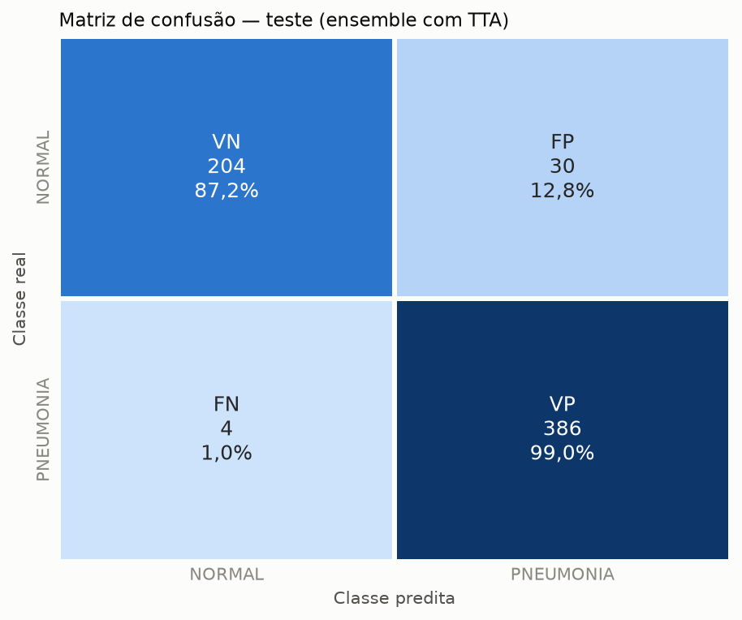
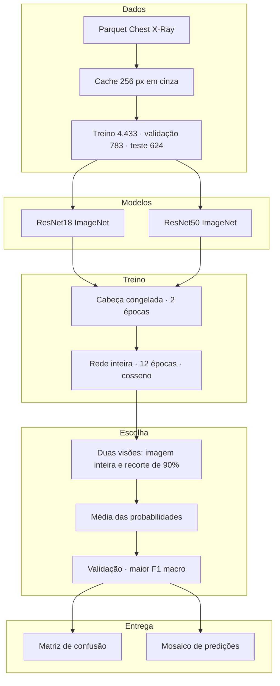
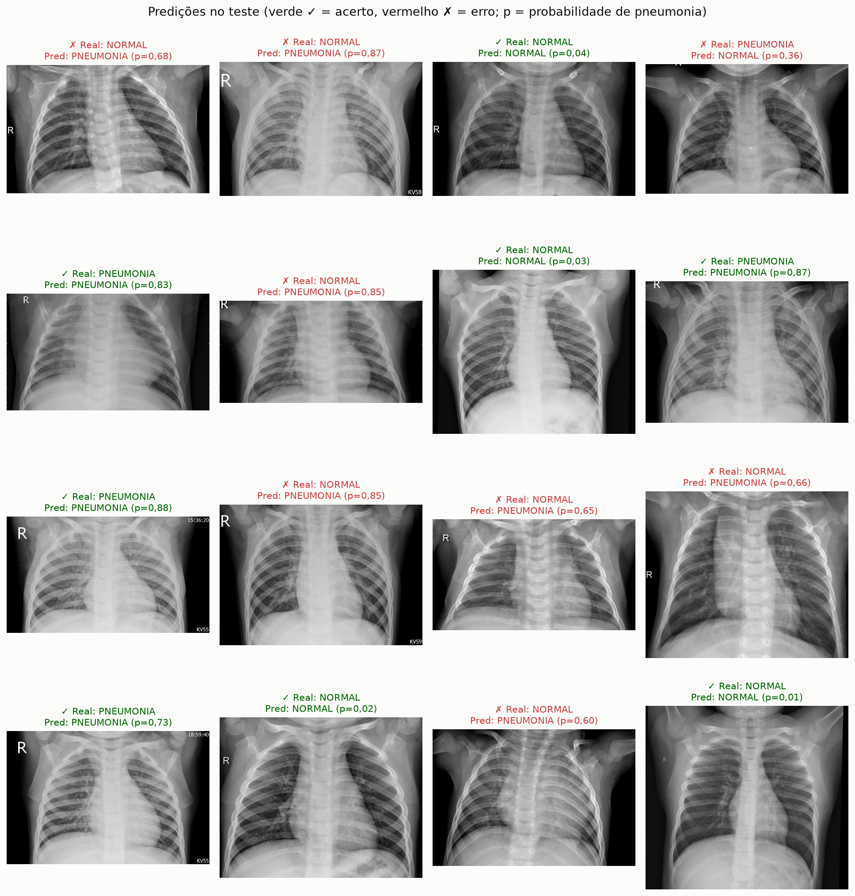
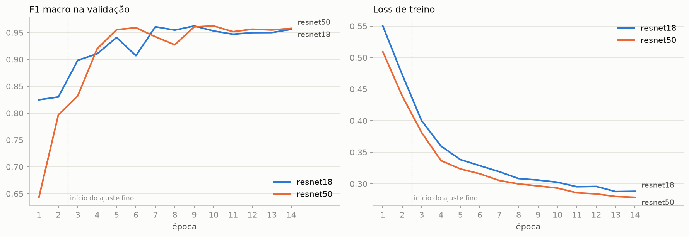

# Raio-X com Deep Learning

**Classificação de pneumonia em radiografias de tórax com transfer learning.**

PyTorch · ResNet18 · ResNet50 · Chest X-Ray Images (Pneumonia)

Repositório: [soninhoxs/raiox_usando_DL](https://github.com/soninhoxs/raiox_usando_DL)



_Teste — 386 verdadeiros positivos, 204 verdadeiros negativos, 30 falsos positivos e 4 falsos negativos._

---

## Sobre o projeto

O notebook classifica radiografias de tórax em `NORMAL` e `PNEUMONIA` com redes convolucionais clássicas pré-treinadas no ImageNet. O recorte é o de um experimento de **transfer learning**: mesma divisão de dados, protocolo de treino explícito e a escolha do modelo feita só na validação. O conjunto de teste entra uma vez, no fim.

A entrega pede dois gráficos que importam num diagnóstico: a **matriz de confusão** (falso positivo e falso negativo) e um **mosaico de predições** do teste, com a classe real e a predita em verde quando o modelo acerta e em vermelho quando erra.

Uso educacional. O modelo não substitui diagnóstico médico.

### Problema

Na primeira versão, a ResNet18 acertava a pneumonia (recall 98,2%) e errava o exame normal: 66 dos 234 casos `NORMAL` viraram pneumonia. A especificidade ficou em 71,8%, a precisão de `PNEUMONIA` em 85,3% e a acurácia em 88,3%. A validação, tirada do mesmo conjunto do treino, mostrava F1 macro 0,950; o teste oficial caía para 0,867.

O treino era curto (3 épocas na cabeça e 2 no último bloco) e o aumento de dados espelhava a radiografia, trocando o coração de lado. Falso negativo continua sendo o erro mais grave, mas a v1 já tinha poucos (7). O que faltava era especificidade.

### Solução

* **Mais adaptação à radiografia** — 2 épocas só na cabeça e 12 na rede inteira, com aquecimento e taxa de aprendizado em cosseno.
* **Duas arquiteturas e a média delas** — ResNet18 e ResNet50, pesos ImageNet. O ensemble usa a média das probabilidades.
* **Aumento que respeita a anatomia** — recorte com zoom, rotação, translação, brilho e contraste. Sem espelhamento horizontal.
* **Regularização** — label smoothing 0,1, AdamW com weight decay e dropout 0,3 na cabeça.
* **Escolha antes do teste** — seis candidatos (cada rede e o ensemble, com e sem teste com aumento). Vence o maior F1 macro na validação. O teste não participa da escolha.
* **Dois gráficos da entrega** — heatmap da matriz de confusão e mosaico 4×4 do conjunto de teste.

---

## Arquitetura



Fluxo: cada radiografia é decodificada uma vez e guardada em 256×256. O treino aplica o aumento em cima desse cache. As duas ResNets seguem o mesmo protocolo. Na inferência, cada rede pode ver a imagem inteira e um recorte central; a probabilidade final do ensemble é a média. O checkpoint de cada rede é o de maior F1 macro na validação. O candidato vencedor — aqui, o ensemble com TTA — é o único avaliado como resultado oficial no teste.

### Divisão dos dados

| Conjunto | Imagens | NORMAL | PNEUMONIA |
| --- | ---: | ---: | ---: |
| Treino | 4.433 | 1.140 | 3.293 |
| Validação | 783 | 201 | 582 |
| Teste | 624 | 234 | 390 |

A validação é 15% do treino original, estratificada, seed 7. O teste é o split oficial do dataset e não entra no treino nem na escolha do modelo. Os pesos de classe compensam o desbalanceamento (cerca de 1,94 para `NORMAL` e 0,67 para `PNEUMONIA`).

---

## Decisões de engenharia

**Transfer learning em duas fases.** A cabeça nova aprende com a base congelada. Depois a rede inteira é liberada com taxa menor. Na v1 só o `layer4` era ajustado, e o melhor estado aparecia na primeira época desse ajuste. Doze épocas com cosseno dão tempo da convolução se adaptar ao raio-X sem esquecer o ImageNet de uma vez.

**Sem flip horizontal.** Espelhar um tórax troca o lado do coração. O aumento cobre o que realmente varia entre exames: enquadramento (zoom 70–100% da área, translação de 5%) e exposição (brilho e contraste ±25%), mais rotação de 10°.

**Regularização contra confiança alta.** Label smoothing 0,1 impede o alvo 0/1 rígido. AdamW usa weight decay 1e-4. A cabeça tem dropout 0,3. A v1 não tinha nenhum desses três, e a precisão de pneumonia era o ponto fraco.

**Ensemble e TTA são candidatos, não um padrão automático.** São seis linhas na tabela de validação. O TTA melhorou a validação do ensemble (F1 macro 0,961 para 0,970) e piorou um pouco o teste (30 falsos positivos, contra 23 sem TTA). O resultado oficial continua sendo o escolhido pela validação. Trocar depois de olhar o teste deixaria a métrica otimista.

**Cache e precisão mista.** Decodificar o JPEG a cada época limitava o número de passadas. A imagem entra na GPU já em 256 px, em precisão mista quando há CUDA. A execução completa levou cerca de 18 minutos numa RTX 3050 Laptop (6 GB).

**Métrica de seleção alinhada às duas classes.** Acurácia sozinha favorece pneumonia, que é a maioria. O F1 macro trata `NORMAL` e `PNEUMONIA` com o mesmo peso, que é o que a v1 precisava subir.

---

## Destaques técnicos

| Área | Implementação |
| --- | --- |
| **Arquiteturas** | ResNet18 e ResNet50 pré-treinadas no ImageNet |
| **Ensemble** | Média das probabilidades das duas redes |
| **Treino** | AdamW, label smoothing, dropout, aquecimento e cosseno |
| **Aumento** | Zoom, rotação, translação, brilho e contraste; sem flip |
| **Inferência** | TTA com imagem inteira e recorte central de 90% |
| **Seleção** | Maior F1 macro na validação; desempate pela menor log loss |
| **Gráficos** | Matriz de confusão, mosaico verde/vermelho, curvas de treino |
| **Hardware** | CUDA com precisão mista; o notebook também roda em CPU |

---

## Resultados

Modelo oficial: **ensemble ResNet18 + ResNet50 com TTA**, escolhido na validação (F1 macro 0,970).

| Métrica | v1 | v2 |
| --- | ---: | ---: |
| Acurácia | 88,3% | **94,6%** |
| Precisão de `PNEUMONIA` | 85,3% | **92,8%** |
| Recall de `PNEUMONIA` | 98,2% | **99,0%** |
| Especificidade | 71,8% | **87,2%** |
| F1 macro | 0,867 | **0,940** |
| AUC | — | **0,989** |
| Falsos positivos | 66 | **30** |
| Falsos negativos | 7 | **4** |

Os três critérios da v2 foram atingidos: acurácia acima de 88,3%, precisão de pneumonia acima de 85,3% e recall de pelo menos 95%. Os falsos positivos caíram para menos da metade sem aumentar os falsos negativos.

O maior ganho veio do protocolo de treino, não da rede mais funda. A ResNet18 sozinha, treinada como na v2 e sem TTA, chega a 95,5% de acurácia no teste. A ResNet50 fica em 94,4%. O ensemble com TTA é o resultado oficial porque ganhou na validação, não porque foi o melhor número depois de ver o teste.

| Candidato no teste | Acurácia | Precisão | Recall | Especificidade | FP | FN |
| --- | ---: | ---: | ---: | ---: | ---: | ---: |
| v1 ResNet18 | 88,3% | 85,3% | 98,2% | 71,8% | 66 | 7 |
| v2 ResNet18 sem TTA | 95,5% | 94,4% | 98,7% | 90,2% | 23 | 5 |
| v2 ResNet18 com TTA | 94,1% | 92,1% | 99,0% | 85,9% | 33 | 4 |
| v2 ResNet50 sem TTA | 94,4% | 93,4% | 98,0% | 88,5% | 27 | 8 |
| v2 ResNet50 com TTA | 94,2% | 92,6% | 98,7% | 86,8% | 31 | 5 |
| v2 ensemble sem TTA | 95,5% | 94,4% | 98,7% | 90,2% | 23 | 5 |
| **v2 ensemble com TTA** | **94,6%** | **92,8%** | **99,0%** | **87,2%** | **30** | **4** |

---

## Galeria


_**Matriz de confusão** — linhas são a classe real, colunas a predita. O falso negativo (pneumonia lida como normal) é a célula de baixo à esquerda: 4 casos. O falso positivo é a de cima à direita: 30 casos._



_**Mosaico** — 16 amostras do teste. O título mostra a classe real e a predita. Verde é acerto, vermelho é erro. A grade mistura os dois para os dois resultados aparecerem._



_**Curvas** — perda e F1 macro de validação da ResNet18 e da ResNet50. A linha tracejada marca o início do ajuste fino da rede inteira._

---

## Como executar

Pré-requisitos: Python 3.11, PyTorch com CUDA (ou CPU) e Jupyter. O ambiente usado aqui foi o conda `projeto_ia`.

```bash
git clone https://github.com/soninhoxs/raiox_usando_DL.git
cd raiox_usando_DL
pip install torch torchvision matplotlib seaborn scikit-learn pandas pyarrow pillow jupyter
```

O dataset não vai no repositório. É o [Chest X-Ray Images (Pneumonia)](https://www.kaggle.com/datasets/paultimothymooney/chest-xray-pneumonia), já exportado em Parquet no formato do Hugging Face (`image.bytes` e `label`, com classes `NORMAL` e `PNEUMONIA`). Aponte `DATA_DIR` no notebook para a pasta local dos arquivos `train-*.parquet` e `test-*.parquet`.

Abra `classificacao_pneumonia_transfer_learning_v2.ipynb` e execute de cima para baixo. Os gráficos saem em `figuras_v2/`. Com GPU, a passagem completa fica na casa dos 20 minutos. Sem GPU, o mesmo protocolo demora bem mais.

---

## Estrutura do repositório

```
├── classificacao_pneumonia_transfer_learning_v2.ipynb
├── figuras_v2/
│   ├── matriz_confusao.png
│   ├── mosaico_predicoes.png
│   └── curvas_treino.png
└── README.md
```

---

## Contato

Experimento de classificação de radiografias com CNNs clássicas e transfer learning.

GitHub: [@soninhoxs](https://github.com/soninhoxs)
